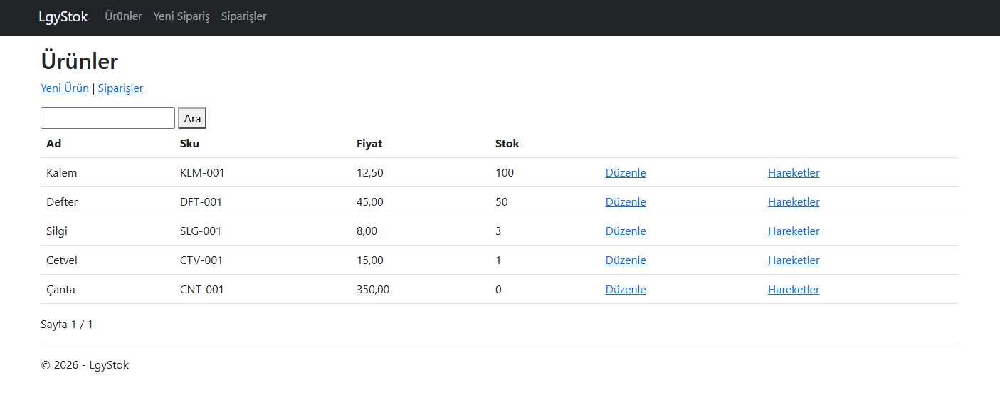
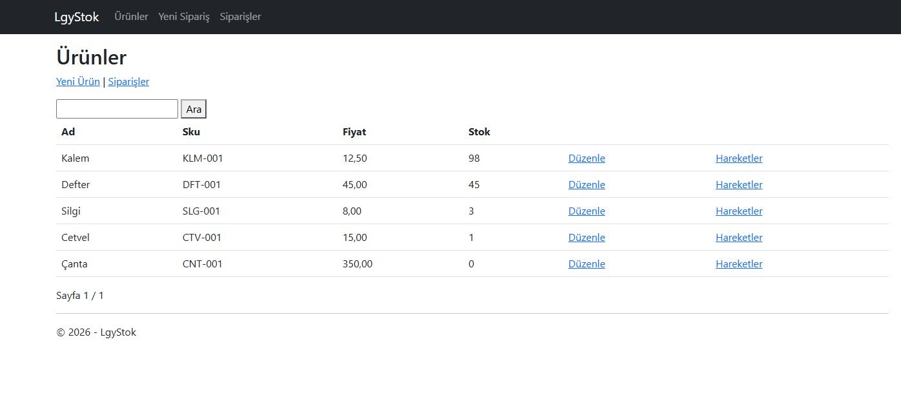
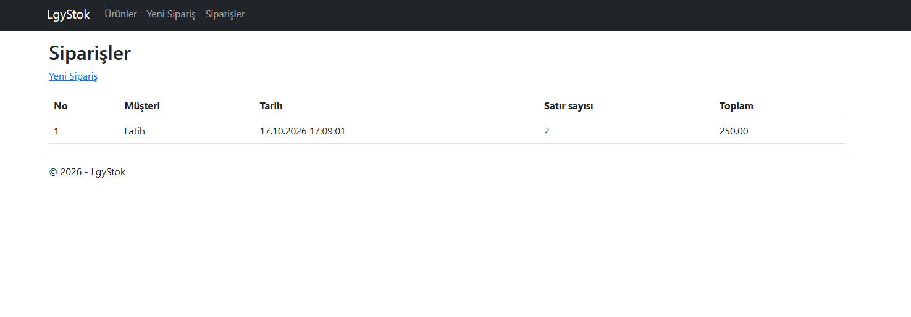
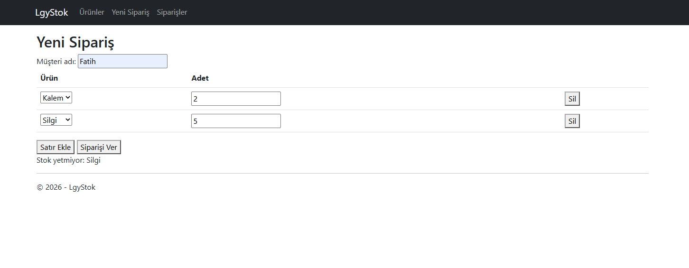
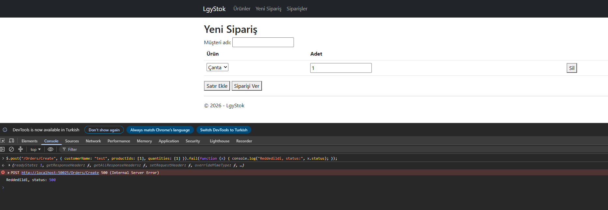

# LgyStok

LgyTech Case, .NET Framework 4.8, ASP.NET MVC 5, Entity Framework 6 (Code First Migrations) ve SQL Server LocalDB kullanılmıştır.

## Gereksinimler

- Windows
- Visual Studio 2022 (ASP.NET and web development iş yükü)
- SQL Server LocalDB veya SQL Server Express

## Kurulum

1. Repo klonlanır: `git clone https://github.com/fatihisikli/LgyStok.git`
2. `LgyStok.sln` dosyası Visual Studio'da açılır. NuGet paketleri derleme sırasında yüklenir. Yüklenmezse Solution üzerinde Restore NuGet Packages seçilir.
3. Connection string `LgyStok/Web.config` içindeki `StokContext` kaydıdır. LocalDB için değişiklik gerekmez. SQL Server Express kullanılacaksa `Data Source` değeri `.\SQLEXPRESS` olarak değiştirilir.
4. Package Manager Console'da (Default project: `LgyStok`) şu komut çalıştırılır:

```
   Update-Database
```

   Veritabanı ve tablolar oluşturulur, seed ile 5 ürün eklenir: Kalem (100), Defter (50), Silgi (3), Cetvel (1), Çanta (0).
5. F5 ile uygulama çalıştırılır. Üst menüden Ürünler, Yeni Sipariş ve Siparişler sayfalarına geçilir. Stok hareketleri, ürün listesinde her ürünün yanındaki Hareketler bağlantısından açılır.

## Veritabanını sıfırlama

A senaryosundaki stok değerleri (98 ve 45) yalnızca temiz veritabanında elde edilir. Uygulama kapalıyken Package Manager Console'da sırayla şu komutlar çalıştırılır:

```
Update-Database -TargetMigration:$InitialDatabase
Update-Database
```

İlk komut tabloları siler, ikincisi tabloları yeniden oluşturup seed verisini yükler. Sıfırlamadan sonra Ürünler sayfası seed verisiyle açılır:



## Kabul senaryoları

### **A: Kalem x 2 + Defter x 5**

Veritabanı sıfırlanır. Yeni Sipariş sayfasında müşteri adı girilir, ilk satırda Kalem (adet 2) seçilir, Satır Ekle ile eklenen ikinci satırda Defter (adet 5) seçilir ve Siparişi Ver düğmesine basılır.

**Beklenen sonuç:** Sipariş oluşur ve sipariş numarası ekranda görünür. Ürünler sayfasında Kalem 98, Defter 45 olur. Kalem ve Defter için Hareketler sayfalarında sırasıyla -2 ve -5 kayıtları görünür (toplam 2 kayıt). Siparişler sayfasında 1 sipariş, 2 satır ve 250 toplam tutar görünür.

**Ürünler sayfası:**



**Siparişler sayfası:**



### **B: Kalem x 2 + Silgi x 5**

Silgi stoğu 3 olduğu için bu sipariş verilince ekranda "Stok yetmiyor: Silgi" mesajı görünür. Sipariş kaydı tek transaction içinde yapıldığından hiçbir kayıt kalmaz: Kalem stoğu değişmez, Siparişler sayfasında yeni sipariş görünmez, Hareketler sayfalarında yeni kayıt olmaz. Sipariş numarası bir atlayabilir, çünkü SQL Server Id sayacını geri almaz.



### **C: Token olmadan sipariş**

Yeni Sipariş sayfası açıkken tarayıcıda F12 ile Console sekmesine geçilir ve şu komut çalıştırılır (Chrome gerekirse önce `allow pasting` yazılmasını ister):

```js
$.post("/Orders/Create", { customerName: "test", productIds: [1], quantities: [1] }).fail(function (x) { console.log("Reddedildi, status:", x.status); });
```

**Beklenen sonuç:** Konsolda `500 (Internal Server Error)` ve `Reddedildi, status: 500` görünür, sipariş kaydedilmez. Sayfadaki Siparişi Ver düğmesi `@Html.AntiForgeryToken()` ile üretilen token'ı gönderir. Bu istek göndermediği için `[ValidateAntiForgeryToken]` tarafından reddedilir.




## Eşzamanlılık (bonus)

İki kullanıcı aynı anda son Cetvel'i sipariş etmeye çalıştığında yalnızca biri başarılı olur. Stok önce okunup sonra düşülseydi iki istek de stoğu 1 görüp ikisi de satış yapabilirdi. Bu yüzden stok kontrolü ve düşümü tek SQL komutunda yapılır:

```sql
UPDATE Products SET Stock = Stock - @adet WHERE Id = @id AND Stock >= @adet
```

Etkilenen satır sayısı 0 ise stok yetmemiştir. Bu durumda transaction geri alınır ve "Stok yetmiyor" mesajı döner. SQL Server aynı satıra gelen iki güncellemeyi sırayla işlediği için ikinci istek güncel stoğu (0) görür ve koşulu geçemez.

### Test

1. Veritabanı sıfırlanır, Cetvel stoğu 1'dir (Ürünler sayfasından kontrol edilir).
2. Yarışı belirginleştirmek için `OrdersController.cs` içindeki `Thread.Sleep(3000)` satırının başındaki `//` işaretleri geçici olarak kaldırılır ve uygulama yeniden başlatılır.
3. Yeni Sipariş sayfası açıkken tarayıcıda F12 ile Console sekmesine geçilir ve şu kod çalıştırılır (Chrome gerekirse önce `allow pasting` yazılmasını ister):

```js
var token = $('input[name="__RequestVerificationToken"]').val();
var cetvelId = $("#rowTemplate option:contains('Cetvel')").val();
function ver() { return $.ajax({ url: "/Orders/Create", type: "POST", traditional: true, data: { __RequestVerificationToken: token, customerName: "yaris", productIds: [cetvelId], quantities: [1] } }); }
$.when(ver(), ver()).done(function (a, b) { console.log(a[0].message, "|", b[0].message); });
```

Beklenen sonuç: Konsolda iki mesajdan biri "Sipariş oluştu, no: ...", diğeri "Stok yetmiyor: Cetvel" olur. Ürünler sayfasında Cetvel stoğu 0 görünür, Siparişler sayfasında Cetvel için tek sipariş bulunur.

Test bittikten sonra `Thread.Sleep` satırı tekrar yorum satırı yapılır.
